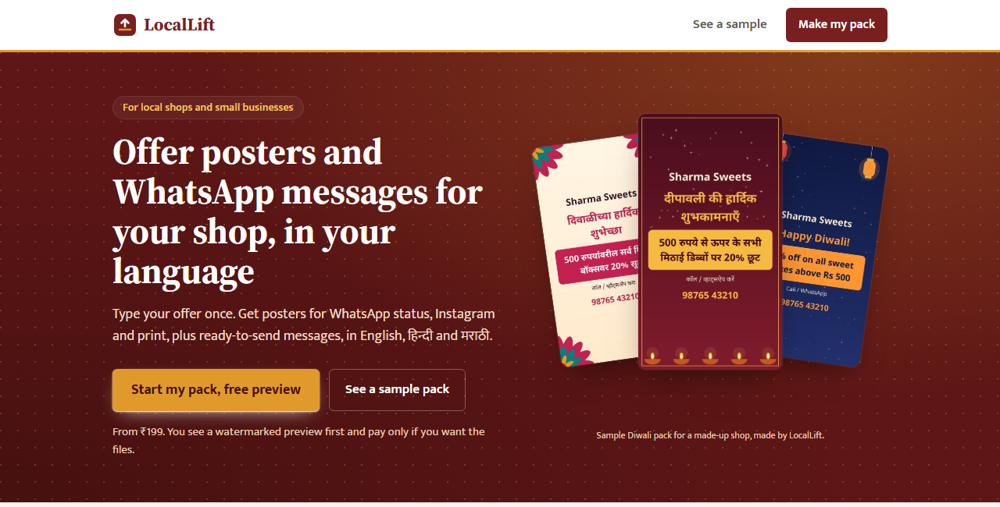
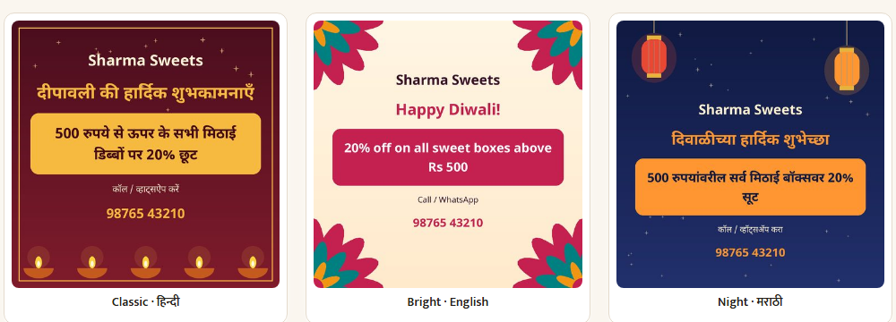
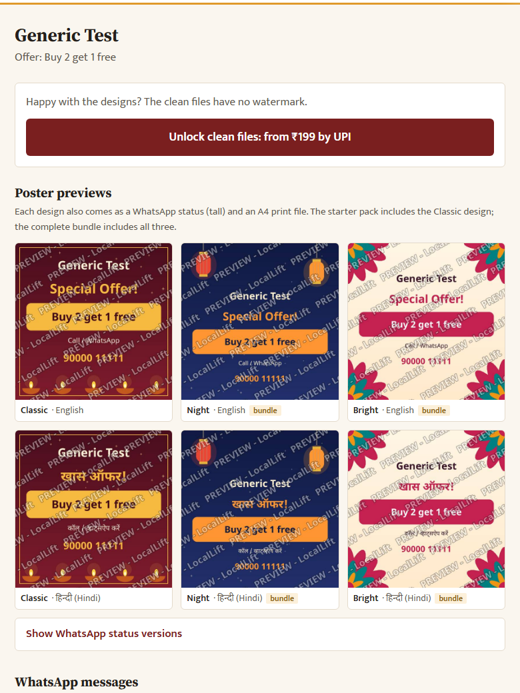
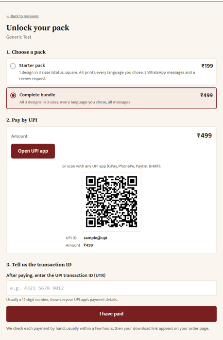
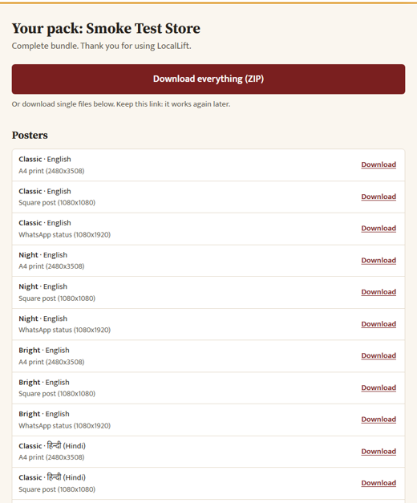

<div align="center">

# LocalLift

**Offer posters and WhatsApp messages for local shops, in their own language, in minutes.**

English · हिन्दी · मराठी

[**Live site**](https://locallift-web-jp8m.onrender.com) · [**Try a sample pack**](https://locallift-web-jp8m.onrender.com/sample) · [How packs are made](pipeline/README.md) · [Submission notes](SUBMISSION.md)


Built for RevHack 2026 by Aditya Chimurkar, Om Soma and Ayush Agnihotri.



</div>

## Why

Small shops run offers all year, from festival sales to weekend discounts, but almost none have a designer. Making posters in several sizes and languages, plus WhatsApp messages, takes hours they do not have. LocalLift turns one short form into a ready-to-post pack, and student reps sell it to shops in person for a commission.

## What a shop gets

| | |
|---|---|
| **Posters** | 3 designs × 3 sizes: WhatsApp status (1080×1920), square post (1080×1080), A4 print (2480×3508) |
| **Languages** | English, Hindi and Marathi, with correct Devanagari shaping |
| **Messages** | 3 WhatsApp broadcast messages and 1 review request per language |
| **Occasions** | General "Special offer" (default) or Diwali |
| **Price** | ₹199 starter pack (1 design) or ₹499 complete bundle (all 3); free watermarked preview first |


<sub>Sample posters for a made-up shop (Diwali occasion), rendered by the pipeline.</sub>

## How it works

1. **Order.** A 60-second form: shop name, phone, offer, languages, occasion, optional logo and rep code.
2. **Preview.** Posters are drawn with Pillow + RAQM and checked automatically: text inside margins, WCAG contrast, phone and offer present, no overlapping lines, no missing glyphs. A failing poster is retried once with a simpler layout.
3. **Pay.** UPI deep link and QR; the shop enters the transaction ID and an admin confirms it.
4. **Download.** Clean PNGs, a ZIP, and messages to copy or send straight on WhatsApp.
5. **Reps.** Referral links (`/r/CODE`), 30% commission recorded in a ledger on approval, payouts tracked in the admin.

<table><tr>
<td></td>
<td></td>
<td></td>
</tr><tr>
<td align="center"><sub>Previews (test order)</sub></td><td align="center"><sub>UPI payment</sub></td><td align="center"><sub>Downloads and messages</sub></td>
</tr></table>

## Honest status (Oct 18, 2026)

- **Traction:** no real shop has paid yet. Everything in the screenshots is a sample or our own test data.
- **Render Workflows:** designed and tested locally (`pipeline/workflow.py`: one task per poster, idempotent, retries), but **not running on Render**, which requires a card for Workflows. Live packs render inside the web service.
- **Limitations:** manual payment confirmation, slow free hosting (about 2 minutes per pack), Hindi and Marathi copy awaiting native-speaker review, no customer accounts. Full list in [SUBMISSION.md](SUBMISSION.md).

## Run it locally

```bash
docker compose up --build                              # http://localhost:8000, admin / localadmin
python tests/smoke.py http://localhost:8000 localadmin # end-to-end check, prints ALL OK
```

Run through Docker: Hindi and Marathi need `libfribidi`, which the Dockerfile installs. Pillow on Windows renders them wrongly.

## Pages

| Path | What |
|---|---|
| `/` | Landing page |
| `/create` | Order form (free watermarked preview) |
| `/o/{token}` | Order page: live progress, previews, pay button, download link once paid |
| `/pay/{token}` | Plan choice, UPI deep link + QR, transaction ID |
| `/d/{token}` | Clean downloads (paid orders only), ZIP, copy / send-on-WhatsApp |
| `/r/{CODE}` | Rep referral link |
| `/sample` | Demo order for a made-up shop, never payable |
| `/admin`, `/admin/funnel` | Approvals, commission ledger, reps, funnel (HTTP basic auth) |

## Deploy on Render

1. **Blueprint:** New → Blueprint → this repo. Creates `locallift-web` (Docker) and `locallift-db` (Postgres). Set `ADMIN_PASSWORD` and `UPI_VPA`; optionally `LLM_PROVIDER=anthropic` and `LLM_API_KEY` (otherwise the human-written copy library is used).
2. **Optional Workflow service** (needs a card on the account): New → Workflow → this repo, start command `python -m pipeline.workflow`, `DATABASE_URL` = internal connection string. Then set `RENDER_API_KEY` and `WORKFLOW_SLUG` on the web service. Details in [pipeline/README.md](pipeline/README.md).

**Env vars:** `DATABASE_URL`, `ADMIN_PASSWORD`, `ADMIN_USER` (admin), `UPI_VPA`, `UPI_NAME`, `PRICE_STARTER` (199), `PRICE_BUNDLE` (499), `LLM_PROVIDER`, `LLM_API_KEY`, `LLM_MODEL` (claude-opus-5-5), `RENDER_API_KEY`, `WORKFLOW_SLUG`, `ORDER_LIMIT_PER_HOUR` (8).

## Project layout

| Folder | Contents |
|---|---|
| `pipeline/` | Poster rendering, QA checks, copy generation and libraries, Render Workflows tasks |
| `web/` | FastAPI app, Jinja2 + HTMX + Tailwind templates, payments, admin |
| `shared/` | `schema.sql` (applied at startup) and the DB helper |
| `ops/` | Traction ledger, CRM template, setup notes |
| `tests/` | End-to-end smoke test and poster render samples |

Fonts: Noto Sans and Noto Sans Devanagari, SIL Open Font License 1.1 (`pipeline/fonts/OFL.txt`).
